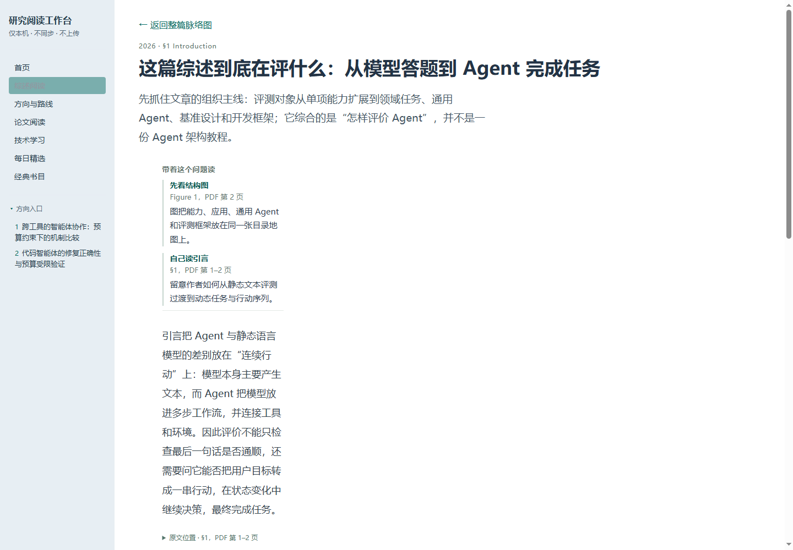
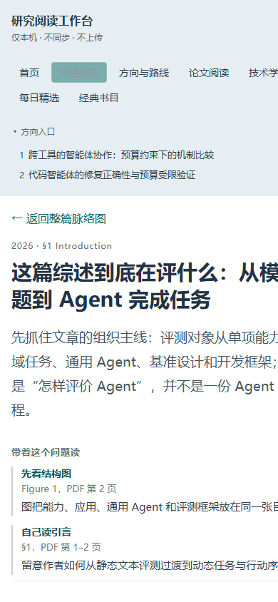

# W0 · 实施基线

- 日期：2026-10-04
- 工作区：`D:\Program Project\ResearchWorkbench`
- 设计：READING-015 v1.0
- 状态：G0 已通过；W1 已获准开始。本文只记录正式产品改动前的基线。

## 代码与工作区

- 分支：`main`
- 基线 HEAD：`45b45d41118f9ea7180dfb5f5da86ec35937c35c`，提交主题“10.01 前端展示全面优化”。
- 开始时的工作区差异：`docs/SPEC.md`、`docs/BACKLOG.md` 有本轮设计导航更新；`demos/` 和 `docs/plans/READING-015/` 是此前 Demo/设计交付。均保留。本阶段未修改 `public/`、`tests/`、`server.mjs` 或 `package.json`。
- 本地只读浏览通过 Node 原服务 `127.0.0.1:4173`；页面只使用已有公共阅读数据。

## 公开内容清单

由当前 `public/library-content.js`、`public/content/` 和 `public/library.js` 只读得到：

| 对象 | 当前数量/值 |
|---|---:|
| 论文 | 55 |
| 起步材料 | 5 |
| 经典文献 | 11，分4组 |
| 研究方向 | 4：2 active、2 deferred |
| 技术路线 | 13 |
| Featured 路线 | `tech-multiagent`、`tech-rag`、`tech-graph-simple` |
| 综述 | 3 篇 partial，共26个单元：12、7、7 |
| 内容标识 | `LIBRARY-CONTENT v5.4` |

代表论文实际交付档和范围：

| ID | 实际交付 | 覆盖 |
|---|---|---|
| `astute-rag` | deep | full-text |
| `tosem2025-acceptance` | standard | partial-text |
| `compass` | quick | abstract |
| `le2018-overfitting` | entry | metadata |
| `beyond-frameworks` | quick | partial-text |

## 测试基线

环境：Node `v24.19.0`。执行 `npm test`：252 项中 250 通过、1 失败、1 跳过。失败为 `tests/editorial-copy.test.mjs`：Node 无法导入被忽略且当前不存在的 `docs/plans/READING-014/prototype/editorial.mjs`，报 `ERR_MODULE_NOT_FOUND`；`.gitignore` 将 `docs/plans/READING-014/prototype` 整目录列入忽略。此文件不在 HEAD/工作区，禁止用重建或放宽该测试掩盖基线缺失。该失败在产品代码改动前发生。

`npm run validate:surveys` 通过：3 篇综述记录结构一致。

上述测试基线用于区分本轮回归；不把既有失败记为视觉改造造成，也不在实施报告中写成全绿。

## 正式站点实页观察

在隔离浏览器中以 `http://127.0.0.1:4173/#/survey/survey-agent-evaluation-2026/unit/survey-scope` 打开公开综述单元；视口设为 1440×1000，以实际 DOM 几何测量：

- 阅读布局：1128.67px，Grid 列为 `220px 760px`。
- `.survey-reader-toc` 实际有0个按钮、`display:none`。
- `.survey-reading-body` 实际宽220px，正文仅有1个章节 heading。
- 浏览器 document width 与 client width 均为1425px，无页面级横向溢出；主要缺陷是正文落入空目录的220px列，右侧形成大片未用于正文的空间。

桌面和手机视口均保存了可复用的正式站截图。隔离 Edge 的 1280、1440 截图表明正文落在窄栏，1440 同时记录了大面积空白；390 视口的 DOM 几何没有页面横溢出，但截图与另一浏览器的显示仍有差异，详见下文。

同一页面在 390×844 下重新测量：正文 346.67px、布局单列、目录按钮 0 个；页面滚动宽度等于 client width 375px，没有页面级横向溢出。当前全站导航自然换为两行。正式手机截图已保存为 `W0-mobile-390-css1.png`。

### 可复用的浏览器工件

在临时 Edge profile、只打开本地 `127.0.0.1:4173` 页面获取并保存；真实文件尺寸已核对：

| 文件 | 像素 | SHA256 |
|---|---:|---|
| [1280 桌面](W0-desktop-1280.png) | 1280×900 | `DC8A840DDAB3E3A4B868BA9DEFF596896F3D62684B7CEC5249C824D0F33694A6` |
| [1440 桌面](W0-desktop-1440.png) | 1440×1000 | `C3CE47F20B008C75A06DC5AE8C218553EE0822116D06C76AAF1A7E8DE1B9195E` |
| [390 手机](W0-mobile-390-css1.png) | 390×844 | `E3F47B9594B2A0B46FAE6A68B4BD9C79648D1F5657590DBCA59090A4F61F9983` |

Edge 手机截图的导航及右侧文本在图中有裁切；之前 IAB 同 viewport 的 DOM 得到 `scrollWidth=clientWidth=375`，图像行为并不一致。以这组可复用截图保留原站事实，不猜测差异原因；W1/AC13 必须在正式浏览器查清，并让修复后的两种浏览器都没有全页横向裁切。

## G0 判定

已经冻结 HEAD、公开数据规模、代表论文档位和三张可复用浏览器工件；同一正式页面实测复现无目录列错位；测试基线失败与忽略文件依赖都有明确记录，可在当前只读状态重复检查。因此 **G0 通过，允许进入 W1**。基线有未解决项不表示产品/视觉通过；全套测试既有失败和 Edge/IAB 手机差异作为实施回归边界，任何验收报告都继续如实注明。

## 实施角色发现

仓库根目录 AGENTS.md 指定 builder 使用用户配置的 `glm-5.3-flash`。用户于 2026-10-04 明确要求由当前主会话直接实施、不交给 glm；本轮因此以当前主会话作为唯一实施者，不声称当前运行模型是 glm，不并行修改相同文件集。角色变更仅来自这条明确用户指示。W0 已经完成并放行，下一阶段按原包继续 W1。
